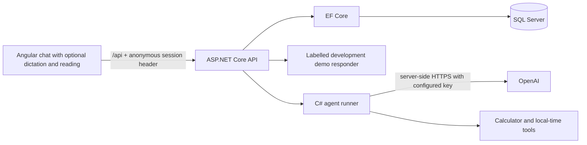

# DADUS AI architecture

The Angular client calls relative `/api` routes. During development, the Angular proxy forwards them to the ASP.NET Core server on the loopback interface. The browser never receives the permanent OpenAI API key.

## Data and ownership

Conversations belong to an anonymous browser session represented by an unguessable GUID stored in local storage and sent as `X-Dadus-Session`. Every conversation/history operation is scoped to that session. The token is a local-development convenience, not authentication; anyone holding it can act as that browser. Do not expose this prototype to untrusted users before adding account authentication, authorization, data-lifecycle controls and deployment hardening.

User and assistant messages are saved together after a successful response. Failed provider requests should not create half-finished exchanges. History uses bounded chronological pages with the original server timestamp as its cursor; clients must not round timestamps.

## Provider configuration

`Chat:Mode` selects `Demo` or `OpenAI`. Demo is restricted to Development and visibly labelled. Live mode uses `DadusOpenAI:ApiKey` only in the server process and a configurable `DadusOpenAI:Model`. The default model is `gpt-4o-mini`; confirm availability for the configured account before depending on it. The integration calls the documented Chat Completions endpoint over HTTPS. Provider failures return a safe application error and do not expose raw provider responses or credentials.

## Runtime configuration

ASP.NET Core reads its standard environment-variable syntax: `ConnectionStrings__Dadus`, `Chat__Mode`, `DadusOpenAI__ApiKey` and `DadusOpenAI__Model`. The application does not source `.env` files. The local SQL helper manages a generated development password and injects the connection string into child processes without printing it. The connection is loopback-only and trusts the local SQL Server development certificate; provider and dependency HTTPS verification remain enabled.

SQL Server data belongs in the named Docker volume, not source control. Live processes must be restarted in new cloud tasks. The cloud tool/cache activation helper lives outside this repository at `/workspace/.cloud-tools/chatbot-env.sh`.

## Optional SQLite development mode

Setting `Database__Provider=Sqlite` explicitly enables a Development-only local database. It allows the demo to run while SQL Server's container download is blocked. The data file lives in the ignored `.local/` directory. This initial disposable schema uses `EnsureCreated`; SQL Server remains the default and uses the checked-in EF migrations. SQLite validation does not establish SQL Server readiness. Provider and database modes are independent: a demo responder can use either storage provider, and live OpenAI replies still require a real key.

## C# agents and tool calls

The static agent catalog defines Companion, Planner and Coding roles. Each request selects an allowed catalog ID. An agent can use only server-defined function tools, not arbitrary model-supplied code. The calculator parses a limited arithmetic grammar, and the time tool validates its time zone. Live responses can include tool calls: the server validates names/arguments, runs bounded local tools, appends tool results, and asks the model for its final answer. The run has a shared deadline and bounded iterations/tool calls. Only final assistant text and concise tool results are returned; internal model reasoning is not exposed.

Agent/tool errors do not bypass session ownership or permit a partial user/assistant exchange to be saved. The agent choice applies to that turn and does not alter the existing message schema. Tool summaries are returned for the current run and are not persisted. History contains the completed user/assistant message pairs. Demo commands can exercise the actual local tools, with explicit demo labelling; simulated model transports belong only in tests.

## Browser voice controls

The Angular voice service detects browser speech recognition and synthesis separately. Recognition starts only after an explicit microphone action, places final transcripts in the draft, and never sends automatically. The selected Marathi/Hindi/English language controls recognition and matching output voices. Reading new replies requires opt-in; an existing reply can be read by its own button. Cancellation invalidates old callbacks when the conversation or language changes, sending begins, or the component is destroyed.

Audio does not pass through the .NET API or enter the conversation schema. Browser speech services may process audio online. Only text explicitly submitted by the user follows the normal chat pipeline. Missing recognition support, denied permission, unavailable languages and absent matching output voices have user-visible notices. This feature does not provide real-time audio streaming, wake words or background listening.

Provider HTTP failures map to fixed application codes for rejected authentication, denied access, quota, rate limits, unavailable models and provider outages. Only a bounded, recognized quota code is read from a provider error body; raw provider messages and credentials are never returned to the client.
